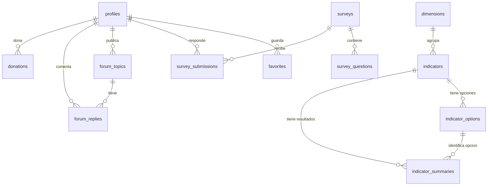

# Plan Maestro — Visión General (Fase 1 y Fase 2)

Este proyecto se divide en **dos fases ágiles** para reducir dependencias entre participantes y construir primero una base sólida de datos, cuentas y encuestas antes de conectar los servicios externos (Stripe y el Asistente IA).

- **[PLAN_FASE1.md](PLAN_FASE1.md):** Base de datos en Supabase, cuentas (`Auth`), sistema de filtrado, encuesta externa Tec, comparativa AMG vs. Tec, comunidad y panel Admin.
- **[PLAN_FASE2.md](PLAN_FASE2.md):** Integración de servicios externos (**Stripe Checkout** para donativos y **Asistente IA `/ask` con Gemini**), más el cierre de seguridad CI / Stage 4.

## Guías Individuales (divididas en Fase 1 y Fase 2)
- [carlos.md](carlos.md) — Base de datos, carga de datos AMG 2026, agregación Tec, seguridad y consultas
- [aaron.md](aaron.md) — Cuentas (`Auth`), almacenamiento seguro, Perfil/Favoritos (Fase 1) y `/ask` con Gemini (Fase 2) — **Integrado en `dev`**
- [genaro.md](genaro.md) — Sistema de filtrado, Comparativa AMG vs. Tec (Fase 1) y pantalla de Chat IA (Fase 2) — **Integrado en `dev`**
- [nico.md](nico.md) — Captura de encuesta Tec, Comunidad, Admin (Fase 1), Stripe Checkout y CI/SBOM (Fase 2) — **Integrado en `dev`**

## Pruebas y CI
- **Suite Jest (`npm test`):** 17 suites unitarias en `src/__tests__/` cubriendo Auth/SecureStore, Favoritos/Perfil, Filtros, Resúmenes offline/remotos, Comparativa AMG vs. Tec, Asistente `/ask`, Encuestas/Borradores AES-GCM, Biometría, Publicación Admin, Comunidad/Foro, Donativos Stripe y Contratos BD.
- **Pruebas Node (`evals/` y `tests/`):** `node evals/ask-edge.test.js`, `node evals/oracles.test.js` y `node --test tests/nico-database.test.mjs`.
- **CI (`.github/workflows/security-checks.yml`):** ejecuta `tsc --noEmit`, `expo lint`, `npm test -- --ci`, `nico-database.test.mjs`, `evals/`, CycloneDX SBOM, `npm audit` y `deno test` de pagos en cada PR/push a `dev` y `main`.

---

## Cómo está estructurada la Base de Datos (`D1` en Supabase)

En lugar de crear una tabla distinta para cada pregunta o dimensión de la encuesta, agrupamos la información analítica en **4 tablas conectadas** (el SQL completo está en [carlos.md](carlos.md)), contemplando desde el inicio las tablas que usará la Fase 2 (`donations` y `assistant_logs`):

1. **`dimensions`**: temas de la encuesta (Bienestar, Educación, Seguridad, etc.).
2. **`indicators`**: preguntas e indicadores con su título, promedio general y si están publicados.
3. **`indicator_options`** *(diccionario)*: opciones válidas de cada pregunta (`1 = Nada satisfecha`, `5 = Muy satisfecha`).
4. **`indicator_summaries`**: totales y porcentajes ya calculados por filtro (`general`, `gender`, `age_group`, `estrato`) y marcados con `dataset_source` (`amg_2026` o `tec_2026`).

---

## Metodología Git (aplica para ambas fases)
- **Ramas por función:** `[nombre]/[funcion-implementada]` (ej. `carlos/supabase-schema`, `nico/encuesta-tec`, `aaron/auth-perfil`, `genaro/filtros-comparativa`).
- **Integración:** todo trabajo parte de `dev` y entra por PR hacia **`dev`** (con revisión de al menos 1 compañero + `npx tsc --noEmit` + `npx expo lint`).
- **Producción:** al cerrar cada fase en `dev`, se abre PR **`dev` $\rightarrow$ `main`**.
