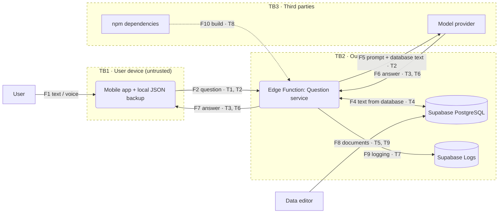
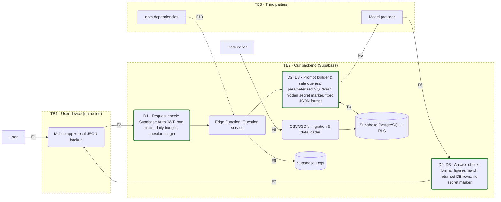

# Threat model: AI assistant of the Jalisco Cómo Vamos app

Team "Whoos?" · Group 502 · Team 5:

Carlos Andrés Gloria Cortes - A00574714  
Nicolas Woo Ruedas - A01645937  
Genaro Mercado Morones - A01647350  
Aaron Hernandez Rodríguez - A00574813

**AI assistance:** We use AI to implement the DFD diagram on mermaid, also we check that the assistant did it correctly. The assistant only create de mermaid code, the design was decided by the whole team.

## 1. Scope and assets

**In scope:** the AI chatbot (`asistente` screen, available from the `Inicio` and `Explorar` tabs) that answers user questions by summarizing and filtering internal app data. This includes the 2026 Youth Wellbeing Survey data migrated from CSV/JSON into a **Supabase PostgreSQL** relational database (10 main indicators across 3 categories and 6 AMG municipalities: El Salto, Guadalajara, San Pedro Tlaquepaque, Tlajomulco de Zúñiga, Tonalá, and Zapopan; N = 1,207), plus internal tables for surveys, news, forum topics, and methodology. It also covers the **local backup** of essential summary data (`src/data/raw/bienestar_jovenes_2026_resumen.json`) kept in the app for offline use, the Supabase Edge Function that builds prompts and runs safe queries, Supabase Auth, logs, npm dependencies, and the model provider.

**Out of scope:** the donation mockup flow (`DonationsScreen.tsx`, SPEI and Apple Pay UI preview), survey collection (`SurveyScreen.tsx`), community forum/news posting, and `@tec.mx` institutional email verification (`VerificationScreen.tsx`).

| Asset                                          | Why it matters                                                                                                                               |
| ---------------------------------------------- | -------------------------------------------------------------------------------------------------------------------------------------------- |
| A1. Credibility of the figures                 | Answers are shown as official Jalisco Cómo Vamos data, so a wrong or invented figure damages the organization, not just the app.             |
| A2. API keys and budget                        | The chatbot is free to use. If requests are not limited, someone can drain the budget, or leak the LLM key or Supabase `service_role` key.   |
| A3. Availability of the chatbot                | If the budget, rate limit, or database service runs out, the chatbot stops working for everyone.                                             |
| A4. User queries (text / voice transcripts)    | What users type or dictate into the chatbot may contain personal data.                                                                       |
| A5. Supabase database & local backup integrity | All figures come from our Supabase PostgreSQL tables (and the local fallback JSON). If altered, answers look official but are wrong.         |

## 2. DFD and trust boundaries

Rectangles = external entities · rounded nodes = processes · cylinders = data stores · dashed lines = trust boundaries. Labels on the arrows show where each threat (T1, T2, ...) happens.

Boundaries:  
TB1 we never trust the user's input  
TB2 the backend we control  
TB3 the model and packages we do not control. We also treat as untrusted all text that reaches the model (the question and the text taken from the database) and everything the model returns.

## 3. Threat table

| ID | Threat | Flow | STRIDE | OWASP | Likelihood | Impact | Status |
| --- | --- | --- | --- | --- | --- | --- | --- |
| T1 | A script sends questions nonstop and drains the budget or quota | F2 | D | LLM06 | High | High | Top 3 |
| T2 | A user writes a question that tricks the assistant therefore it ignores its rules, goes off-topic in JCV's name, or reveals its hidden instructions (prompt injection) | F2, F5 | E, I | LLM01, LLM08 | High | Medium | Top 3 |  
| T3 | The model invents or mixes up figures and attributes them to JCV | F6, F7 | T | LLM07 | High | High | Top 3 |  
| T4 | A text in the database contains instructions that the model follows (indirect injection) | F4 | T, E | LLM01, LLM05 | Low | High | Accepted |  
| T5 | Someone without permission adds or edits rows in Supabase and corrupts the database | F8 | T, S | LLM05, LLM09 | Low | High | Accepted |  
| T6 | The app shows the model's answer without checking it | F6, F7 | T, E | LLM10 | Medium | Medium | Accepted |  
| T7 | Personal data that users say or type ends up stored in the logs | F9 | I | LLM02 | Medium | High | Accepted |  
| T8 | A compromised npm package, or a model change we did not control | F10 | T | LLM04 | Low | High | Accepted |  
| T9 | Database changes with no record of who made them | F8 | R | LLM05 | Low | Medium | Accepted |

## 4. Prioritization

| Impact \ Likelihood | Low        | Medium | High       |
| ------------------- | ---------- | ------ | ---------- |
| **High**            | T4, T5, T8 | T7     | **T1, T3** |
| **Medium**          | T9         | T6     | **T2**     |
| **Low**             |            |        |            |

**Top 3: T1, T3, T2.** T1 and T3 are high likelihood and high impact. The app is free and open to students, so abuse of the question service is the most likely scenario, and a false figure attributed to JCV directly damages our most valuable asset . T2 is chosen over T7 because students are very likely to try to trick a public assistant, and its defense and test are simple and give a clear pass/fail result. T7 is reduced by a design decision: we do not store the text of the questions. We did not follow the OWASP order: T4 is outside the top 3 because we control the database, so its likelihood is low.

## 5. Updated DFD with defenses

D1, D2, and D3 are the planned defenses for T1, T2, and T3.

## 6. Mitigation and test plan (top 3)

| ID  | Requirement                                                                                                                                                                                                                                                                      | Defense (where)                                                                                                                                                                                                                                                                                   | Test type · input                                                                                                                                                                                                                              | Oracle (pass/fail check)                                                                                                                                                        | Pipeline stage                                                                  | Residual risk                                                                                                                                        |
| --- | -------------------------------------------------------------------------------------------------------------------------------------------------------------------------------------------------------------------------------------------------------------------------------- | ------------------------------------------------------------------------------------------------------------------------------------------------------------------------------------------------------------------------------------------------------------------------------------------------- | ---------------------------------------------------------------------------------------------------------------------------------------------------------------------------------------------------------------------------------------------- | ------------------------------------------------------------------------------------------------------------------------------------------------------------------------------- | ------------------------------------------------------------------------------- | ---------------------------------------------------------------------------------------------------------------------------------------------------- |
| T1  | The 31st question from the same user within 60 seconds is rejected (status 429). A question longer than 500 characters is rejected (status 413). When the USD 15 daily limit is reached, the service answers 503 and does not call the model.                                                                                                           | D1: a check inside the Supabase Edge Function before calling the model. The app sends a **Supabase Auth JWT** (using the public `anon` key; `service_role` and LLM keys stay only on the server). The check allows at most 30 requests per minute per user and IP address, tracks daily spending, limits question length, and sets a maximum answer length. | Integration test · 31 questions in a row from one JWT/IP with the model replaced by a fake; one question of 501 characters; spending counter set to the daily limit                                                                              | Status codes: 200 for the first 30 and 429 for the 31st; 413 for the long question; 503 with zero calls to the fake model at the limit                                                                | On every pull request                                                           | Attacks spread across many accounts or IP addresses; an attacker can use up the daily limit and block legitimate users                               |
| T3  | Every figure in a summarized or filtered answer appears in the Supabase rows returned for that request, with the correct municipality or category label (AMG overall or one of the 6 municipalities), and the answer names at least one source. If no relevant data is found, the answer is the fixed message "I don't have that data in the 2026 Youth Wellbeing Survey". | D3: the Edge Function runs **safe, parameterized Supabase queries/RPCs** (the model never writes raw SQL) and tells the model to summarize or filter only from those returned rows, in the format `{answer, sources[]}`. The answer check verifies the format, compares every figure against the returned rows, and confirms each source exists. | Unit test · fixed model answers with a correct figure, an invented figure, and a figure with the municipality or category label swapped (e.g., Guadalajara vs. Zapopan). Evaluation · 20 questions with the real model: 10 with data (including filtered queries), 5 without data, 5 asking for a figure that does not exist | Automatic check: valid format, every figure matches the returned Supabase rows, every source exists, questions without data get the exact fixed message. Target: 0 figures without support | Unit tests on every pull request; evaluation with the real model before merging | A real figure that is misread or used in a wrong comparison; figures written in words; wrong data already in the database (T5)                       |
| T2  | In 15 trick questions, the answer never contains the secret marker hidden in the instructions. Off-topic questions get the standard refusal. The hidden instructions contain no secrets.                                                                                         | D2: hidden instructions kept separate from the question (which is marked as plain data); a secret marker text placed inside the hidden instructions; an answer check that blocks any answer containing the marker or lacking valid sources and returns a generic message. The model has no tools. | Evaluation · 15 trick questions (ask for the instructions, "ignore your instructions", change the assistant's role, off-topic questions). Unit test · simulated answers that contain the marker                                                | Marker text not found in the answer; valid format; answers without valid sources are replaced by the standard refusal                                                           | Unit tests on every pull request; security evaluation before merging            | New tricks that do not trigger the check; a rewritten (paraphrased) version of the hidden instructions leaking (low impact: they contain no secrets) |

## 7. Accepted threats

| ID  | Justification and existing control                                                                                                                                           |
| --- | ---------------------------------------------------------------------------------------------------------------------------------------------------------------------------- |
| T4  | We migrate the database from verified JCV CSV/JSON files. Rows sent to the model are marked as plain data, and the T3 answer check blocks answers that are not supported by the returned rows. |
| T5  | Supabase **Row Level Security (RLS)** allows read-only (`SELECT`) access for app users; only authenticated `editor`/`admin` roles can insert or update rows, and migration scripts are reviewed in pull requests. |
| T6  | The React Native app renders chatbot answers strictly inside `<Text>` components as plain text (no `WebView`, HTML rendering, or automatic link opening), and the fixed format from T3 limits what can appear. |
| T7  | Design decision: Supabase logs store the user/session ID, date, question length, and status code, never the question text itself.                                                       |
| T8  | `package-lock.json` is versioned, `npm audit` runs in CI, and the model version is pinned.                                                                                   |
| T9  | Supabase tables keep `updated_by` and `updated_at` audit columns for data edits, and the local essential backup (`bienestar_jovenes_2026_resumen.json`) is versioned in Git. |
